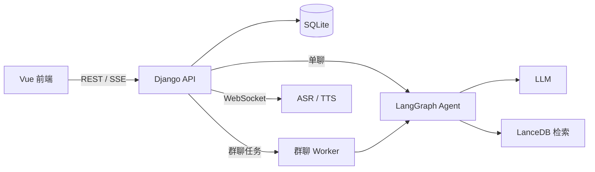

# AIFriends

AI 虚拟角色聊天应用，支持角色创作、文字与语音单聊，以及多 AI 角色群聊。

[快速开始](#快速开始) · [功能与实现](#功能与实现) · [评测](test/README.md) · [前端开发](frontend/README.md)

## 功能与实现

- **角色与好友**：自定义人设、头像、背景和音色，浏览角色并建立独立的好友会话。
- **流式单聊**：LangGraph 编排模型与工具调用；通过 SSE 输出文字和语音，VAD 支持语音输入与播放打断；一次回复按内容分为 1–3 个气泡。
- **AI 群聊**：从好友卡片邀请角色，支持成员头像、移除成员、随机或指定单个角色回复，以及独立会话缓存。
- **消息可靠性**：客户端 UUID 去重、消息状态管理、版本游标补偿断线期间的更新；失败可手动重试，任务执行版本校验拒绝旧结果写入。
- **上下文与检索**：单聊使用独立的滚动记忆摘要与近期问答；群聊按发言者组织近期记录；LanceDB 提供 Top-3 知识库检索。
- **音色复刻**：管理员上传 WAV（16-bit PCM）、MP3 或 M4A，生成音色并加入音色库；服务端校验权限，普通用户仅选择已有可见音色。
- **评测基线**：32 条固定用例，覆盖消息交付、恢复、上下文保留、事实更正、角色一致性和隔离；支持离线检查与真实模型评测。

## 技术栈

| 层级 | 技术 |
| --- | --- |
| 前端 | Vue 3、Vite、Pinia、Tailwind CSS、daisyUI |
| 后端 | Django 6、Django REST Framework、SimpleJWT、SQLite |
| AI | LangGraph、LangChain、OpenAI 兼容接口、LanceDB |
| 语音与通信 | WebSocket ASR/TTS、SSE、vad-web、MediaSource |



## 快速开始

需要 Python 3.12+、Node.js 20（≥20.19）或 ≥22.12，以及可用的模型与语音服务配置。

### 1. 安装后端依赖

在项目根目录执行，以下命令使用 Windows PowerShell：

```powershell
python -m venv .venv
.\.venv\Scripts\Activate.ps1
pip install -r requirements.txt
```

创建 `backend/.env`，按自己的服务填写：

```dotenv
API_KEY=your-api-key
API_BASE=your-openai-compatible-base-url
WSS_URL=your-speech-websocket-url
VOICE_URL=your-voice-enrollment-api-url
VOICE_PUBLIC_BASE_URL=https://your-public-backend-domain
```

`API_KEY`、`API_BASE` 用于聊天、记忆和 Embedding；`WSS_URL` 用于语音；最后两项用于音色复刻。模型名称目前在对应调用代码中配置，音色复刻与 TTS 的目标模型必须匹配。

### 2. 启动后端

```powershell
cd backend
python manage.py makemigrations
python manage.py migrate
python manage.py createsuperuser
python manage.py runserver
```

后端地址：<http://127.0.0.1:8000>。`runserver` 自动启动一个群聊 worker，本地开发无需额外启动任务进程。

首次运行在 `/admin/` 为新建的管理员添加 `UserProfile`，再添加 `Voice`（名称、提供方音色 ID），并配置 `SystemPrompt` 的 `回复`、`记忆` 两类提示词。管理员以 Django 的 `is_staff` 权限为准。

### 3. 启动前端

在另一个终端的项目根目录执行：

```powershell
cd frontend
npm install
npm run dev
```

访问 <http://localhost:5173>。前端默认同源请求，Vite 自动将 API 和媒体请求代理到后端。

语音输入首次需要准备浏览器资源，命令见 [前端说明](frontend/README.md#语音输入资源)。

### 4. 打包到后端

在 `frontend/` 执行：

```powershell
npm run build
```

产物写入 `backend/static/frontend/`。保持后端运行，访问 <http://127.0.0.1:8000> 即可使用打包后的页面。

## 可选配置

- **知识库**：将文本放入 `backend/web/documents/data.txt`，在 `backend/` 执行以下命令。它会调用 Embedding API，并覆盖现有 `my_knowledge_base` 表。

  ```powershell
  python manage.py shell -c "from web.documents.utils.insert_document import insert_document; insert_document()"
  ```

- **音色复刻公网地址**：`VOICE_PUBLIC_BASE_URL` 必须能让语音提供方通过 HTTPS 访问本地后端，可使用反向代理或 Cloudflare Tunnel。后端生成临时签名下载 URL，无需公开整个音频目录。
- **独立群聊 worker**：使用 WSGI/ASGI 部署时，在 `backend/` 另运行 `python manage.py run_group_worker`；当前 worker 顺序处理群聊回复。

## 评测

在项目根目录、激活虚拟环境后执行：

```powershell
python test/run.py
```

默认离线，使用独立临时数据库，不调用 LLM 或语音 API。JSON/CSV 报告输出到 `test/results/`；用例筛选、真实模型模式及评分边界见 [评测说明](test/README.md)。

## 项目结构

```text
AIFriends/
├── backend/
│   ├── backend/          # Django 配置
│   └── web/
│       ├── models/       # 用户、角色、好友、群聊数据
│       ├── views/        # API、Agent、语音、记忆与群聊 worker
│       ├── management/   # 启动与后台任务命令
│       └── documents/    # 知识库入库与检索
├── frontend/src/         # 页面、组件、状态与通信
├── test/                 # 固定评测集与回归测试
└── requirements.txt
```

## 当前范围

群聊是“当前用户 + 多个 AI 角色”的私有会话，尚无其他真人成员、群聊语音或群聊长期记忆。单聊记忆为滚动摘要，结构化、可编辑的长期记忆系统尚未实现。

数据库、媒体、密钥、知识库与 VAD 资源不随仓库分发。模型、音色及接口可用性取决于所配置的服务；离线评测结果不代表真实模型回答准确率。
